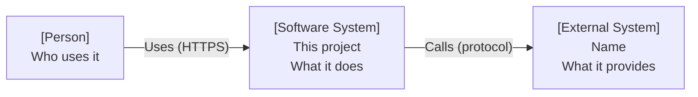
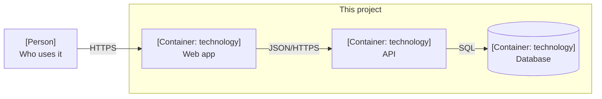

# Architecture

C4 model, levels 1 and 2. Decisions behind this structure: `docs/adr/`. Diagrams are Mermaid
`flowchart`s so they render on GitHub and in the editor without a plugin.

## 1. System context

Who uses the system and which external systems it talks to.

| Element | Type | Responsibility |
| --- | --- | --- |
| TODO: | Person / External system | TODO: |

## 2. Containers

Each separately deployable or running unit: apps, services, databases, queues, file stores.

| Container | Technology | Responsibility | Source |
| --- | --- | --- | --- |
| TODO: | TODO: | TODO: | `TODO:` |

## 3. Key flows

Only flows that cross containers and are not obvious from the diagrams (sign-in, payment,
realtime join). One Mermaid `sequenceDiagram` each.

## 4. Deployment

Where each container runs (host, region, orchestrator), how it is reached (domain, port, proxy),
and how it is deployed (`tools/deploy.sh`).

## 5. Cross-cutting

Authentication, configuration and secrets, logging and tracing, error handling: one line each,
linking the ADR or doc that holds the detail.
